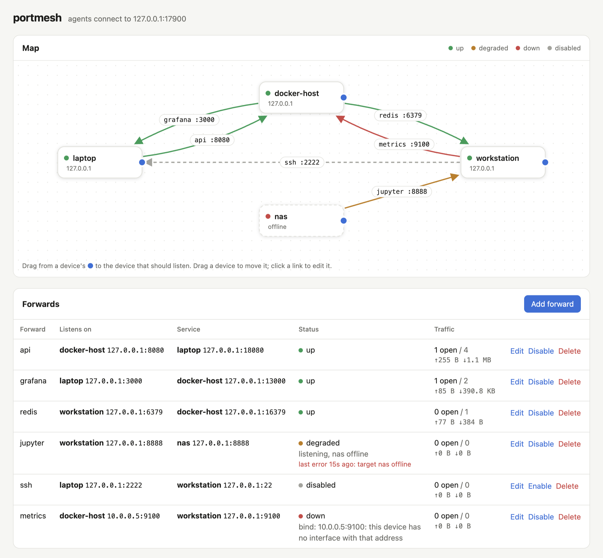

# portmesh

Port forwards between your machines, managed from one web page. Each device runs an agent that keeps one outbound TLS connection to a controller; a forward makes `bind_addr:port` on one device carry traffic to `host:port` on another, relayed through the controller. No device needs to accept inbound connections from another, so it works across firewalls, NAT and macOS Local Network privacy, and a forward can bind any local address, such as a docker bridge gateway, not only loopback.

The web UI shows a map of devices: drag from the device that runs a service to the device that should listen, type the port, done. Each forward shows live status (listening, bind errors with the process holding the port, open sessions, bytes) and can be edited, disabled or deleted from the map or the table.



See [DESIGN.md](DESIGN.md) for how it works and why it is not built on an existing tunnel.

## Run the controller

The controller is one container. It listens on `7900` for agents (TLS) and `7901` for the web UI, which has no login: keep it on a trusted network.

```sh
make deploy DEPLOY_HOST=user@docker-host            # builds, copies to /opt/portmesh, runs docker compose up
```

`DEPLOY_HOST` and `DEPLOY_DIR` can also live in a git-ignored `local.mk`. State and the controller's TLS key live in `data/` next to the compose file; deleting `data/cert.pem` changes the fingerprint every agent pins, so every agent then needs reinstalling.

Install commands point agents at the host you opened the UI on. If that name does not work for agents (a reverse proxy in front of the UI, for example), set `PORTMESH_AGENT_ADDR=host:7900` and `PORTMESH_BASE_URL=http://host:7901` in a `.env` next to the compose file.

## Add a device

Add it in the UI and run the command it shows on the device. It installs `/usr/local/bin/portmesh`, `/etc/portmesh/agent.json`, and a service running as the user who ran `sudo`:

- macOS (arm64): LaunchDaemon `io.portmesh.agent`, log in `/var/log/portmesh-agent.log`. A daemon starts at boot without a login and is not subject to Local Network privacy, which would block a LaunchAgent from reaching the controller.
- Linux (amd64, arm64): systemd unit `portmesh-agent`, log in `journalctl -u portmesh-agent`.

Running the command again upgrades the binary; "New token" in the UI re-keys a device.

## Remove an agent

- macOS: `sudo launchctl bootout system/io.portmesh.agent && sudo rm /Library/LaunchDaemons/io.portmesh.agent.plist /usr/local/bin/portmesh && sudo rm -r /etc/portmesh`
- Linux: `sudo systemctl disable --now portmesh-agent && sudo rm /etc/systemd/system/portmesh-agent.service /usr/local/bin/portmesh && sudo rm -r /etc/portmesh`

## Develop

`go test ./...` runs an end-to-end test (a controller and two agents echoing bytes through a forward); `make build` cross-compiles the agent binaries into `dist/bin`.
